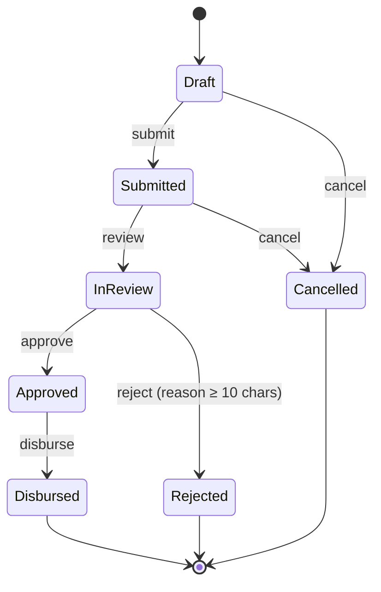
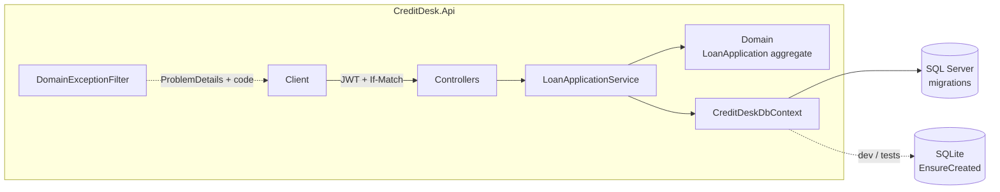

# CreditDesk API

> A loan-origination REST API: applicants build and submit a credit file, analysts review, decide and disburse — with a rich domain model, a single-table state machine and optimistic concurrency exposed through ETags.

[](https://github.com/edu-tech220/credit-desk-api/actions/workflows/ci.yml)


---

## 📖 Overview

CreditDesk is an **ASP.NET Core 8** REST API for the lifecycle of a **loan application**: the applicant assembles their file (amount, term, guarantors and documents) and submits it; a credit analyst picks it up, approves or rejects it and disburses it. Business rules live in the domain, consistency is protected by optimistic concurrency and database indexes, and everything ships with automated tests, Docker and CI.

In a self-service lending portal the hard problems are not CRUD, but:

- **Validating the complete file before it reaches the credit desk** — amount and term within the product limits, repayment capacity (monthly payment vs. income), guarantors when the amount requires them, and mandatory documents. All errors are returned together so the applicant can fix everything in one pass.
- **Preventing two analysts from taking the same application**, and preventing a user from overwriting changes they never saw.
- **Preventing an applicant from having two open applications for the same product**, even under simultaneous requests.
- **Traceability** — who changed the status, when, and why.

## 🔄 State machine



## ✅ Business rules

| Rule | Where it lives | Response |
|---|---|---|
| Amount / term within product limits | `LoanProduct.CollectTermsErrors` | 422 |
| Monthly payment ≤ max % of income (French amortization) | `LoanApplication.Submit` | 422 |
| Guarantor required above threshold; combined guarantor income ≥ 1 monthly payment | `LoanApplication.Submit` | 422 |
| Product's mandatory documents present | `LoanApplication.Submit` | 422 |
| Valid RFC (Mexican tax ID), max 2 guarantors, no duplicates | `LoanApplication.AddGuarantor` | 422 / 409 |
| Only editable while in draft, and only by its owner | `LoanApplication` | 409 / 403 |
| Allowed transitions (single table) | `LoanApplication.AllowedTransitions` | 409 |
| Only the assigned analyst can decide and disburse | `LoanApplication.EnsureAssignedAnalyst` | 403 |
| One open application per applicant and product | service + filtered unique index | 409 |
| Concurrent change / stale version | `Version` token + `If-Match` | 409 / 412 |

### Seeded products

| Code | Amount range | Terms (months) | Annual rate | Max payment / income | Guarantor above | Required documents |
|---|---|---|---|---|---|---|
| `PERSONAL` | 5,000 – 300,000 | 6, 12, 18, 24, 36 | 32% | 35% | 100,000 | ID, proof of address, proof of income |
| `NOMINA` (payroll) | 3,000 – 150,000 | 6, 12, 24 | 22% | 40% | — | ID, proof of income |
| `PYME` (SME working capital) | 50,000 – 2,000,000 | 12, 24, 36, 48 | 26% | 30% | 250,000 | ID, proof of address, proof of income, bank statement |

> **Scope:** documents are registered as metadata (type and file name). File storage (blob storage, antivirus scanning) is intentionally out of scope.

## 🏗️ Architecture

A single API project organized by folders. For this scope, splitting into four assemblies would add ceremony without isolating anything that currently needs isolation. The boundary that matters is respected: **the domain does not depend on EF Core or ASP.NET**, and controllers never change state directly.



- **Domain** — entities and rules: `LoanApplication` (aggregate root), `LoanProduct`, `Amortization`, domain exceptions.
- **Data** — EF Core `DbContext`, SQL Server migrations, catalog and analyst seeding.
- **Services** — `LoanApplicationService`: visibility rules, `If-Match` handling, persistence and conflict translation.
- **Controllers** — Auth, Products (catalog and loan simulator), Applications (queries and commands).
- **Contracts** — request/response DTOs (entities are never serialized directly).
- **Security** — JWT token service, PBKDF2 password hashing.
- **Infrastructure** — exception filter → `ProblemDetails`, ETag helpers.

## 🧠 Technical decisions

- **Rich domain model.** `LoanApplication` exposes behavior (`Submit`, `StartReview`, `Approve`, …) with private setters; transitions come from a single table. A new rule is verified with a unit test — no HTTP needed.
- **Portable optimistic concurrency.** Instead of `rowversion` (SQL Server only), a `Version` GUID column marked `IsConcurrencyToken` is renewed by the domain on every change. It behaves the same on SQL Server and SQLite and is exposed as an `ETag`. Commands accept `If-Match`: a stale version → **412**; if the race happens between the read and the `UPDATE`, EF throws `DbUpdateConcurrencyException` → **409**.
- **Database-backed invariants.** "One open application per product" is checked in the service *and* enforced with a filtered unique index (`[IsOpen] = 1`), because two simultaneous requests can both pass the service check.
- **Consistent errors (RFC 7807).** Each domain exception becomes a `ProblemDetails` with a stable `code` (`invalid_transition`, `open_application_exists`, `concurrency_conflict`, …). Malformed input → 400 (model validation); business-rule violations → 422. An MVC filter is used so expected errors are not logged as server failures.
- **Money in `decimal`.** French amortization is computed without `double`, rounding to cents per period; the last payment absorbs the remainder so the balance closes at exactly 0 (covered by several test scenarios).
- **Private by default.** An applicant requesting someone else's application gets **404**, not 403, so its existence is not revealed. Analysts cannot self-register through the API — they are created from configuration.
- **Security.** JWT with roles (`Applicant`, `Analyst`); PBKDF2-SHA256 password hashing (100,000 iterations, random salt, constant-time comparison); per-IP fixed-window rate limiting on `/api/auth/*` (10 requests/minute by default, `429` when exceeded); the same message for unknown user and wrong password. The JWT signing key is required at startup (≥ 32 bytes) and is never committed for real environments (only a local development value in `appsettings.Development.json`).
- **Versioned migrations for SQL Server**; SQLite (development and tests) creates the schema from the model. CI fails if the model changed without a new migration (`dotnet ef migrations has-pending-model-changes`).
- **Split queries** load the aggregate (guarantors, documents and audit trail) without a cartesian explosion; SQL Server connections use `EnableRetryOnFailure`.
- **Injected `TimeProvider`** instead of scattered `DateTime.UtcNow` calls.

## 🧰 Tech stack

| Area | Technology |
|---|---|
| Language / runtime | C# 12, .NET 8 (SDK pinned via `global.json`) |
| Web | ASP.NET Core 8 Web API (controllers), Swagger / OpenAPI |
| Persistence | Entity Framework Core 8 — SQL Server 2022, SQLite |
| Auth & security | JWT Bearer, PBKDF2, ASP.NET Core rate limiting |
| Testing | xUnit, `WebApplicationFactory` |
| DevOps | Docker, Docker Compose, GitHub Actions |

## 🚀 Getting started

### Local (SQLite, no dependencies)

```bash
dotnet run --project src/CreditDesk.Api --launch-profile http
# Swagger: http://localhost:5180/swagger
```

In `Development` the API uses `creditdesk-dev.db` (SQLite) and seeds the analyst `analista@creditdesk.local` with the development password defined in `appsettings.Development.json`.

### Docker Compose (API + SQL Server 2022)

```bash
cp .env.example .env          # change the passwords and the JWT signing key
docker compose up --build
# Swagger: http://localhost:8080/swagger
```

The API waits for SQL Server to be healthy (healthcheck), applies migrations and seeds the catalog and the analyst account defined in `.env`. A `GET /health` endpoint is also exposed.

### Quick walkthrough

```bash
# 1. Register an applicant and keep the token
TOKEN=$(curl -s -X POST localhost:8080/api/auth/register -H "Content-Type: application/json" \
  -d '{"email":"ana@example.com","fullName":"Ana López","password":"Secreta#2026"}' | jq -r .accessToken)

# 2. Create a draft, attach documents and submit
ID=$(curl -s -X POST localhost:8080/api/applications -H "Authorization: Bearer $TOKEN" -H "Content-Type: application/json" \
  -d '{"productCode":"NOMINA","amount":30000,"termMonths":12,"monthlyIncome":15000}' | jq -r .id)
curl -s -X PUT localhost:8080/api/applications/$ID/documents -H "Authorization: Bearer $TOKEN" \
  -H "Content-Type: application/json" -d '{"type":"OfficialId","fileName":"ine.pdf"}'
curl -s -X PUT localhost:8080/api/applications/$ID/documents -H "Authorization: Bearer $TOKEN" \
  -H "Content-Type: application/json" -d '{"type":"ProofOfIncome","fileName":"nomina.pdf"}'
curl -s -X POST localhost:8080/api/applications/$ID/submit -H "Authorization: Bearer $TOKEN"
```

## 🧪 Running tests

```bash
dotnet test
```

**55 tests**, no external services required:

| Suite | Tests | Covers |
|---|---:|---|
| Unit — `LoanApplicationTests` | 24 | Valid and invalid transitions, aggregated file validation, repayment capacity, guarantors, RFC, audit trail |
| Unit — `AmortizationTests` | 11 | Exact closing of the amortization schedule across scenarios |
| Integration — `ApplicationsApiTests` | 20 | Auth and roles, 404 for other users' resources, 409 / 412 / 422 with their `code`, FIFO inbox paging, and a **real race** |

Integration tests run against the real API via `WebApplicationFactory` with a temporary SQLite file per factory (a file rather than `:memory:` so concurrent connections share the database). The race test fires **12 simultaneous requests from 3 analysts** to take the same application — exactly one wins and the rest receive `409`.

## ⚙️ CI

`.github/workflows/ci.yml`: restore → build → test (`.trx` results uploaded as an artifact) → pending-migration check → Docker image build.

## 📡 API endpoints

| Method | Route | Role | Description |
|---|---|---|---|
| POST | `/api/auth/register` | Public (rate-limited) | Register an applicant |
| POST | `/api/auth/login` | Public (rate-limited) | Returns a JWT |
| GET | `/api/products` | Public | Product catalog |
| GET | `/api/products/{code}/quote?amount=&termMonths=` | Public | Loan simulator with amortization schedule |
| GET | `/api/applications?status=&productCode=&page=&pageSize=` | Both | Paged; applicants see their own, analysts see all (`status=Submitted` in FIFO order) |
| GET | `/api/applications/{id}` | Both | Details with guarantors, documents, audit trail and `ETag` |
| GET | `/api/applications/{id}/schedule` | Both | Amortization schedule |
| POST | `/api/applications` | Applicant | Create a draft |
| PUT | `/api/applications/{id}/terms` | Applicant | Change amount, term and income |
| POST / DELETE | `/api/applications/{id}/guarantors[/{guarantorId}]` | Applicant | Add / remove guarantors |
| PUT | `/api/applications/{id}/documents` | Applicant | Register a file document (replaces one of the same type) |
| POST | `/api/applications/{id}/submit` · `/cancel` | Applicant | Submit / cancel |
| POST | `/api/applications/{id}/review` · `/approve` · `/reject` · `/disburse` | Analyst | Credit desk decisions |

## 📁 Project structure

```
credit-desk-api/
├── .github/workflows/ci.yml     # Build, test, migration check, Docker build
├── docker-compose.yml           # API + SQL Server 2022
├── Dockerfile
├── .env.example                 # Secrets template for Docker Compose
├── global.json                  # Pinned .NET SDK
├── CreditDesk.sln
├── src/CreditDesk.Api/
│   ├── Contracts/               # Request / response DTOs
│   ├── Controllers/             # Auth, Products, Applications
│   ├── Data/                    # DbContext, migrations, seeder
│   ├── Domain/                  # LoanApplication aggregate, LoanProduct, Amortization, exceptions
│   ├── Infrastructure/          # Domain exception filter, ETags
│   ├── Security/                # JWT, PBKDF2
│   ├── Services/                # LoanApplicationService
│   └── Program.cs
└── tests/CreditDesk.Tests/
    ├── Unit/                    # Pure domain and amortization tests (no database)
    └── Integration/             # Real API with WebApplicationFactory + temporary SQLite
```
